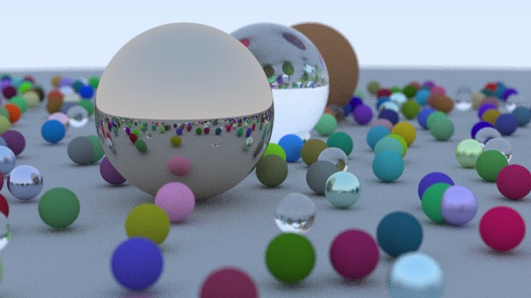
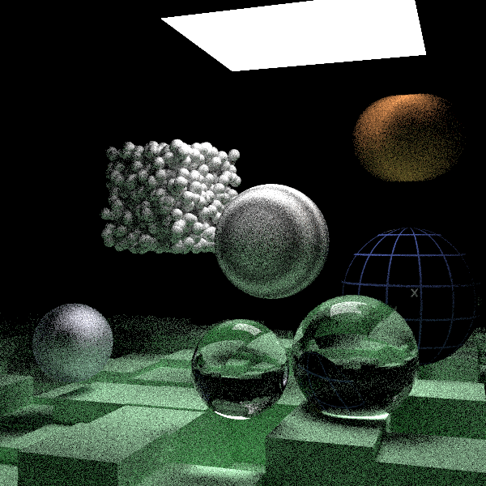

Following: https://raytracing.github.io
  https://github.com/RayTracing/raytracing.github.io/

(samples_per_pixel = 100)

(samples_per_pixel = 70)

TODO:
Resetting the arena doesn't call destructors so they need to be either tracked in Arena or called manually. 
Without destructors, vector instances would remain in memory - leak.
Use arena where cleanup objects/structs don't need cleanup (desctructor call).
